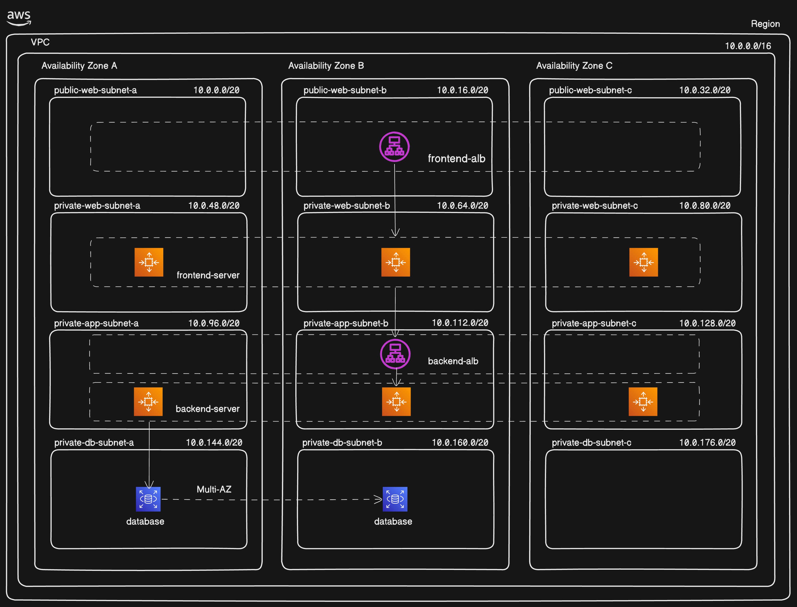

# Highly Available 3-Tier Application on AWS (Terraform + AI Alert Analyzer)

A "Hello World" message app deployed on a highly available 3-tier AWS architecture, fully provisioned with **Terraform**. Users can view and add messages stored in MySQL. An **AI-powered alert analyzer** (CloudWatch → SNS → Lambda → Gemini API) turns raw alarms into incident summaries with suggested remediation steps.



## Architecture

| Tier | Technology | Where it runs |
|---|---|---|
| Web (Presentation) | HTML, CSS, JavaScript on NGINX | EC2 Auto Scaling Group behind an internet-facing ALB |
| App (Logic) | PHP API | EC2 Auto Scaling Group behind an internal ALB |
| Database (Data) | Amazon RDS MySQL (Multi-AZ) | Private subnets |
| Observability | CloudWatch, SNS, Lambda, Gemini API | Alarms → AI summary → Email |

**Request flow:** User → Public ALB → Web servers (NGINX) → Internal ALB → App servers (PHP) → RDS MySQL

NGINX serves the static frontend and proxies `/api/` calls to the internal ALB.

## Network Design

VPC CIDR: `10.0.0.0/16`, spread across **3 Availability Zones** (A, B, C) with 12 subnets of `/20` each.

| Subnet | AZ-A | AZ-B | AZ-C | What runs here |
|---|---|---|---|---|
| Public Web | `10.0.0.0/20` | `10.0.16.0/20` | `10.0.32.0/20` | Frontend ALB, NAT Gateway |
| Private Web | `10.0.48.0/20` | `10.0.64.0/20` | `10.0.80.0/20` | Frontend servers (NGINX) |
| Private App | `10.0.96.0/20` | `10.0.112.0/20` | `10.0.128.0/20` | Backend ALB, Backend servers (PHP) |
| Private DB | `10.0.144.0/20` | `10.0.160.0/20` | `10.0.176.0/20` | RDS MySQL (Multi-AZ) |

DB subnets have **no route to the internet** (not even via NAT).

## Tech Stack

EC2, VPC, ALB, Auto Scaling, NAT Gateway, RDS MySQL, Security Groups, IAM, SSM Parameter Store, CloudWatch, SNS, Lambda, Terraform, NGINX, PHP, Gemini API

## Key Features

- Custom VPC with public and private subnets across 3 Availability Zones
- Internet-facing ALB for the web tier and internal ALB for the app tier
- Auto Scaling Groups with ELB health checks, self-healing and CPU target-tracking scaling
- RDS MySQL with Multi-AZ standby in private subnets (not publicly accessible, encrypted at rest)
- NAT Gateway for secure outbound access from private instances
- **Infrastructure as Code:** entire stack provisioned with Terraform (`terraform plan` to review changes before applying)
- **AI-powered alert analyzer:** CloudWatch alarms are summarized by Gemini into severity, likely causes and next steps, and delivered by email
- **Least-privilege IAM:** separate roles for web, app and Lambda; app role can read only the DB password parameter
- **No hard-coded secrets:** DB password is generated by Terraform and stored in SSM Parameter Store (SecureString); the Gemini API key is stored the same way
- **No SSH:** instances are managed through AWS Systems Manager Session Manager; IMDSv2 enforced

## Security Group Chaining

`Internet → ALB → Web → App ALB → App → RDS`

| Security Group | Allows | From |
|---|---|---|
| Web ALB | HTTP 80 / HTTPS 443 | Internet (`0.0.0.0/0`) |
| Web Servers | HTTP 80 | Web ALB SG |
| App ALB | HTTP 80 | Web Servers SG |
| App Servers | HTTP 80 | App ALB SG |
| RDS | MySQL 3306 | App Servers SG |

Each tier only accepts traffic from the tier in front of it, so the database is never exposed to the internet.

## AI-Powered Alert Analyzer

```
CloudWatch Alarm ──► SNS (alarms) ──► Lambda ──► Gemini API
                                         │
                                         ▼
                              SNS (summaries) ──► Email
```

Alarms created by Terraform:

| Alarm | Watches |
|---|---|
| `web-alb-5xx` / `app-alb-target-5xx` | 5xx errors on the public / internal ALB |
| `web-unhealthy-hosts` / `app-unhealthy-hosts` | Unhealthy targets in each target group |
| `app-asg-high-cpu` | App tier average CPU > 80% |
| `rds-high-cpu` / `rds-low-storage` | RDS CPU > 80% / free storage < 2 GB |

When an alarm fires, the Lambda sends the alarm details to the Gemini API and emails back a structured summary (**severity, summary, likely causes, next steps**). Recovery (`OK`) notices are sent without AI. If the Gemini API is unreachable, the raw alert is still delivered, so alerting never depends on the AI call.

Code: [`ai-alert-analyzer/lambda_function.py`](./ai-alert-analyzer/lambda_function.py) (standard library + boto3 only, no extra dependencies).

## Project Structure

```
├── frontend/              # index.html, styles.css
├── backend/api/           # get_messages.php, save_message.php, db_connection.php
├── database/              # database_setup.sql
├── infrastructure/        # server setup notes and NGINX config
├── terraform/
│   ├── versions.tf        # providers
│   ├── variables.tf
│   ├── vpc.tf             # VPC, 12 subnets, IGW, NAT, route tables
│   ├── security_groups.tf
│   ├── rds.tf             # Multi-AZ RDS + generated password in SSM
│   ├── alb.tf             # public + internal ALBs, target groups
│   ├── asg.tf             # IAM roles, launch templates, ASGs, scaling policies
│   ├── monitoring.tf      # CloudWatch alarms, SNS, Lambda, Gemini key in SSM
│   ├── outputs.tf
│   ├── terraform.tfvars.example
│   └── templates/         # EC2 user-data scripts (web + app)
└── ai-alert-analyzer/
    ├── lambda_function.py
    └── sample_alarm_event.json   # test event for the Lambda
```

## Deployment (Terraform)

**Prerequisites:** AWS CLI configured, Terraform >= 1.5, a [Gemini API key](https://aistudio.google.com/apikey).

```bash
cd terraform
cp terraform.tfvars.example terraform.tfvars   # set alert_email and gemini_api_key
terraform init
terraform plan        # review what will be created
terraform apply
```

1. Confirm the SNS subscription email that AWS sends to `alert_email`.
2. Wait ~5 minutes for the instances to bootstrap, then open the `web_alb_dns` output URL in your browser.

Terraform creates the instances from the latest Amazon Linux 2023 AMI and configures them with user-data scripts that clone this repo, so no manual AMI baking is needed.

> `terraform.tfvars` contains secrets and is git-ignored. Never commit it.

### Manual deployment (AWS Console)

The same architecture can be built by hand:

1. Create the VPC
2. Create subnets (web public, web private, app private, DB private) in 3 AZs
3. Create route tables and associate them with the subnets
4. Create and attach an Internet Gateway
5. Create a NAT Gateway in a public subnet
6. Add routes: public → IGW, private → NAT
7. Create security groups (Web ALB, Web, App ALB, App, RDS)
8. Create the DB subnet group and the RDS MySQL database
9. Create the Web ALB and App ALB with their target groups
10. Create the Web server AMI (install NGINX, Git)
11. Create the App server AMI (install PHP, Apache, MySQL client, Git; run the DB script)
12. Create Launch Templates for both tiers
13. Create Auto Scaling Groups for both tiers and attach them to the target groups
14. Open the Web ALB DNS name in the browser to test

## Testing

- App loads through the public ALB DNS name
- Messages can be added and displayed from the database
- Terminated an instance, and Auto Scaling replaced it automatically
- RDS is not reachable from the internet
- Alert analyzer: force an alarm and check your inbox for the AI summary:

```bash
aws cloudwatch set-alarm-state \
  --alarm-name three-tier-app-app-unhealthy-hosts \
  --state-value ALARM --state-reason "Manual test"
```

You can also invoke the Lambda directly with `ai-alert-analyzer/sample_alarm_event.json` from the Lambda console's Test tab.

## Cleanup

To avoid charges (NAT Gateway, RDS Multi-AZ and the ALBs cost money while running):

```bash
cd terraform
terraform destroy
```

If you built the stack manually, delete in this order: Auto Scaling Groups → Load Balancers → RDS → NAT Gateway (and Elastic IP) → AMIs and Launch Templates → Security Groups → VPC.
