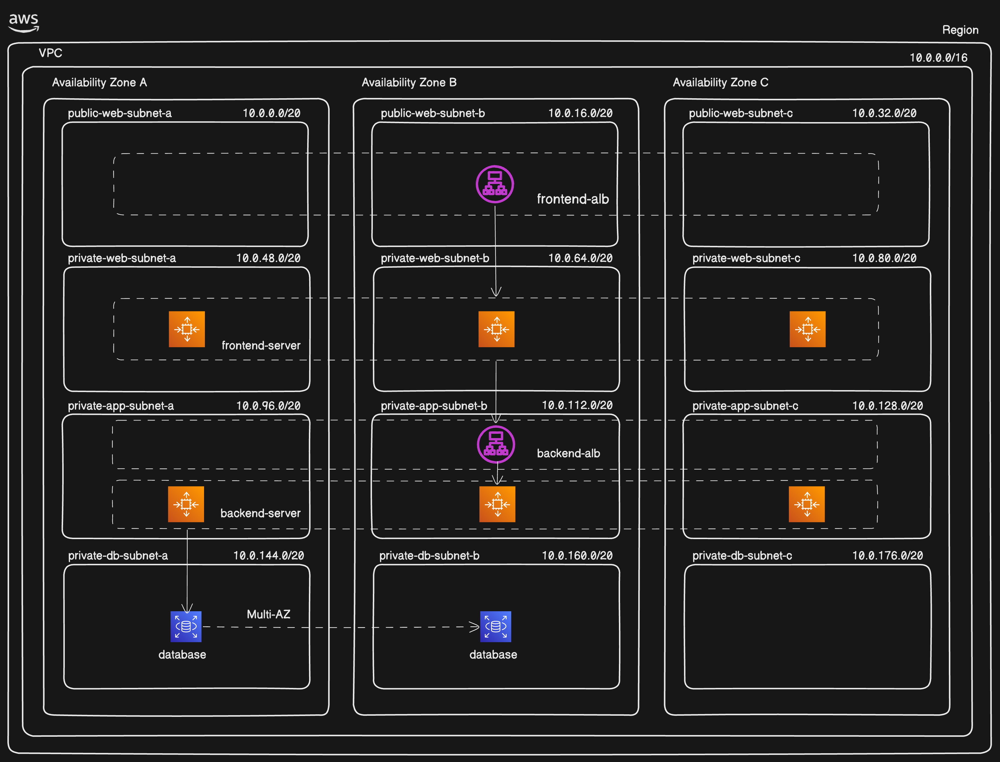

# Highly Available 3-Tier Application on AWS

A simple "Hello World" message app deployed on a highly available 3-tier AWS architecture. Users can view and add messages, which are stored in a MySQL database.



## Architecture

| Tier | Technology | Where it runs |
|---|---|---|
| Web (Presentation) | HTML, CSS, JavaScript on NGINX | EC2 Auto Scaling Group behind an internet-facing ALB |
| App (Logic) | PHP API | EC2 Auto Scaling Group behind an internal ALB |
| Database (Data) | Amazon RDS MySQL | Private subnets |

**Request flow:** User → Public ALB → Web servers → Internal ALB → App servers → RDS MySQL

## Network Design

VPC CIDR: `10.0.0.0/16`, spread across **3 Availability Zones** (A, B, C) with 12 subnets of `/20` each.

| Subnet | AZ-A | AZ-B | AZ-C | What runs here |
|---|---|---|---|---|
| Public Web | `10.0.0.0/20` | `10.0.16.0/20` | `10.0.32.0/20` | Frontend ALB, NAT Gateway |
| Private Web | `10.0.48.0/20` | `10.0.64.0/20` | `10.0.80.0/20` | Frontend servers (NGINX) |
| Private App | `10.0.96.0/20` | `10.0.112.0/20` | `10.0.128.0/20` | Backend ALB, Backend servers (PHP) |
| Private DB | `10.0.144.0/20` | `10.0.160.0/20` | `10.0.176.0/20` | RDS MySQL (Multi-AZ) |

## Tech Stack

EC2, VPC, ALB, Auto Scaling, NAT Gateway, RDS MySQL, Security Groups, NGINX, PHP

## Key Features

- Custom VPC with public and private subnets across multiple Availability Zones
- Internet-facing ALB for the web tier and internal ALB for the app tier
- Auto Scaling Groups for load distribution and self-healing
- RDS MySQL with Multi-AZ standby in private subnets (not publicly accessible)
- NAT Gateway for secure outbound access from private instances
- Custom AMIs and Launch Templates for repeatable deployments

## Security Group Chaining

`Internet → ALB → Web → App ALB → App → RDS`

| Security Group | Allows | From |
|---|---|---|
| Web ALB | HTTP 80 / HTTPS 443 | Internet (`0.0.0.0/0`) |
| Web Servers | HTTP 80 | Web ALB SG |
| App ALB | HTTP 80 | Web Servers SG |
| App Servers | HTTP 80 | App ALB SG |
| RDS | MySQL 3306 | App Servers SG |

Each tier only accepts traffic from the tier in front of it, so the database is never exposed to the internet.

## Project Structure

```
├── frontend/          # index.html, styles.css
├── backend/api/       # get_messages.php, save_message.php, db_connection.php
├── database/          # database_setup.sql
└── infrastructure/    # server setup notes and NGINX config
```

## Deployment Steps

1. Create the VPC
2. Create subnets (web public, web private, app private, DB private) in 3 AZs
3. Create route tables and associate them with the subnets
4. Create and attach an Internet Gateway
5. Create a NAT Gateway in a public subnet
6. Add routes: public → IGW, private → NAT
7. Create security groups (Web ALB, Web, App ALB, App, RDS)
8. Create the DB subnet group and the RDS MySQL database
9. Create the Web ALB and App ALB with their target groups
10. Create the Web server AMI (install NGINX, Git)
11. Create the App server AMI (install PHP, Apache, MySQL client, Git; run the DB script)
12. Create Launch Templates for both tiers
13. Create Auto Scaling Groups for both tiers and attach them to the target groups
14. Open the Web ALB DNS name in the browser to test

## Testing

- App loads through the public ALB DNS name
- Messages can be added and displayed from the database
- Terminated an instance, and Auto Scaling replaced it automatically
- RDS is not reachable from the internet

## Cleanup

To avoid charges, delete resources in this order: Auto Scaling Groups → Load Balancers → RDS → NAT Gateway (and Elastic IP) → AMIs and Launch Templates → Security Groups → VPC.
